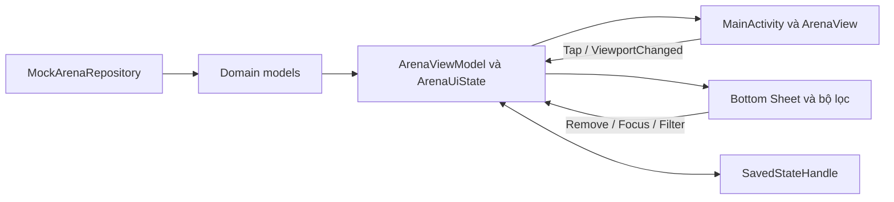
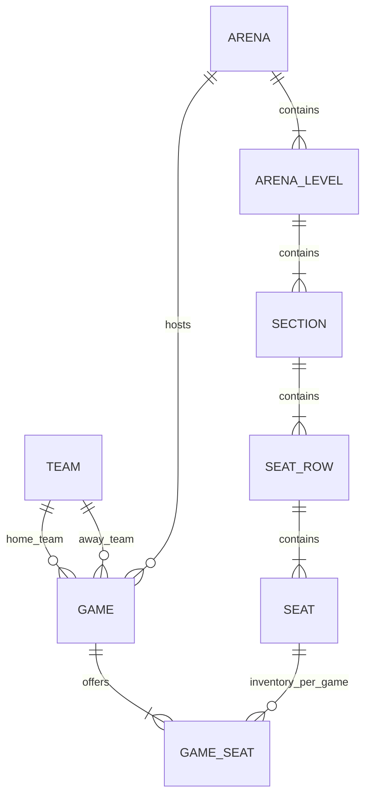
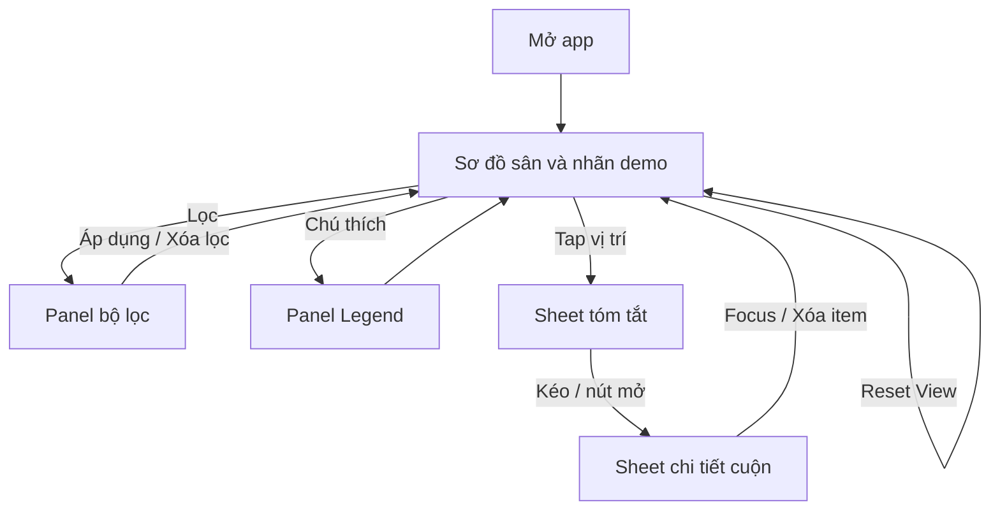

# Thiết kế NBA Ticket Purchasing — Phase 1

Ngày: 2026-11-24. Trạng thái: **Đã được người dùng làm rõ phạm vi toàn arena; giải pháp kỹ thuật tiếp tục là đề xuất để review, chưa triển khai application code**.

Nguồn: [đề thi, 5 trang](sources/De_thi_giua_ky_CNTN2024.pdf), diễn giải có mã tại [REQUIREMENTS.md](REQUIREMENTS.md). Các ưu tiên P0/P1, kiến trúc, dữ liệu, UX và test dưới đây là đề xuất của AI; chưa phải quyết định được người dùng chấp thuận.

Đã đối chiếu lại với [AGENTS.md](../AGENTS.md), đặc biệt mục 2–3 và 7, ngày 2026-11-24. Java/Views/XML, Android Custom View, Canvas/Matrix và kiểm thử là ràng buộc phải tuân thủ. Theo chỉ dẫn mới của người dùng, thiết kế phải bao quát toàn bộ arena, nhiều tầng/section/hàng/ghế và hỗ trợ hàng nghìn đến hàng chục nghìn ghế. Phạm vi này đã được xác nhận; mật độ cụ thể, nguồn dữ liệu và các lựa chọn kỹ thuật ở mục 10 chưa được duyệt toàn bộ.

## 1. Mục tiêu và chức năng theo rubric

Ứng dụng Android mô phỏng **toàn bộ một NBA Arena**, với sân bóng trung tâm, nhiều tầng khán đài, nhiều section, hàng ghế và từng ghế có ID riêng. Màn mở đầu nhìn tổng thể arena; người dùng đi từ tầng/section/hàng xuống ghế, chọn/bỏ ghế, xem danh sách và tổng giá giả lập. Kiến trúc phải hỗ trợ hàng nghìn đến hàng chục nghìn ghế, không có giới hạn thiết kế 200 ghế. P0 chưa bao gồm phát hành vé hoặc thu tiền.

### Phân biệt phạm vi sản phẩm và hồ sơ rubric

- **Phạm vi người dùng đã chốt:** toàn arena nhiều tầng với dữ liệu và hình học từng ghế. Khả năng mở rộng, culling, mức chi tiết và spatial index thuộc nền P0 của sản phẩm, không đẩy thành P1 tùy chọn.
- **Fixture ban đầu:** khoảng 200 ghế phân bố trên toàn bố cục nhiều tầng/section để kiểm tra chức năng nhỏ; không phải chỉ xây một section rồi coi là toàn arena. Cùng schema, pipeline và index với dataset lớn.
- **Rubric gốc:** yêu cầu/checklist 50–250, rubric 150–250 đối tượng. Profile `rubric-small` có thể dùng 200 ghế trên toàn sơ đồ thu nhỏ; profile `full-arena` kiểm tra quy mô lớn. Không coi số ghế đang nhìn thấy trong cửa sổ là tổng số đối tượng của profile.
- Profile nhỏ là công cụ kiểm tra/đối chiếu đề, không giới hạn schema, camera, state hoặc số ghế cuối. Các chỗ còn ghi mục tiêu 200 trong REQUIREMENTS phản ánh phương án rubric ban đầu, được hiểu theo profile nhỏ khi đối chiếu DESIGN sửa đổi này; không thay số liệu đề gốc.
- Quy mô lớn vượt khoảng số lượng của đề: cần xác nhận giảng viên cách nộp/minh họa hai profile. Chưa có xác nhận rằng full-arena hàng chục nghìn ghế được chấm như đúng nguyên văn rubric; không âm thầm thay toàn bộ sản phẩm bằng bản nhỏ để giải quyết điểm này.

| Rubric | Trọng số | Thiết kế P0 | Yêu cầu |
| --- | --- | --- | --- |
| Canvas, bố cục, hiệu năng | 25% | Một ArenaView toàn arena, nhiều tầng/section/hàng/ghế; culling/LOD/index; fixture nhỏ để đối chiếu số lượng rubric | REQ-01–03, 13; phạm vi toàn arena từ người dùng |
| Tương tác, tọa độ | 25% | Pan có biên, pinch đúng tâm, Matrix/inverse chung, hit-test biên | REQ-04–06 |
| Chức năng, UX | 20% | Legend, filter, reset mượt, sheet thu gọn/mở rộng, focus/xóa đồng bộ | REQ-07–11 |
| Kiến trúc, state | 15% | Model độc lập, ViewModel giữ state, giữ lựa chọn khi xoay, hỗ trợ dọc/ngang | REQ-12 |
| Chất lượng, ổn định | 10% | Kiểm tra dữ liệu, gesture/lifecycle/biên, build và runtime | REQ-14 và các luồng P0 |
| Hồ sơ, quy trình | 5% | Git, README, video và AI log trung thực | REQ-15–18 |

50% trọng số nằm ở Canvas và tương tác nên làm phần này trước mở rộng bán vé. Thiết kế không chứng minh chức năng đã hoạt động hoặc đã đạt điểm.

**P0 — đề gốc và phạm vi người dùng:** toàn arena nhiều tầng/section/hàng/từng ghế; schema không khóa số lượng; rendering/hit-test có culling/LOD/index; trạng thái trực quan; pan/pinch/tap; legend; lọc tầng/section; điều kiện/xóa lọc/empty state; reset; sheet thu gọn/mở rộng/cuộn/focus/xóa; đồng bộ; giữ selection khi xoay; dọc/ngang; kiểm tra quy mô lớn, build/chạy và hồ sơ. Phần toàn arena là yêu cầu người dùng bổ sung, không giả thành nội dung đề PDF. Tổng giá vẫn là mock.

**P1 — mở rộng sau P0:** tìm mã ghế; filter trạng thái/loại kết hợp; nhiều trận và màn chọn trận; xác nhận đặt vé mô phỏng; lịch sử đơn và vé demo. Chỉ thực hiện nếu còn thời gian và được duyệt.

**Ngoài phạm vi hiện tại:** tài khoản, backend, API NBA trực tiếp, tồn kho nhiều người dùng, giữ ghế theo thời gian, thanh toán thật, vé QR dùng tại sân, thông báo. Đề không bắt buộc các phần này; không suy diễn từ chữ Purchasing.

## 2. Kiến trúc ứng dụng và package

Giữ **Java + Android Views/XML**, một module `app`, một `MainActivity` mỏng; đề xuất ViewModel + LiveData + SavedStateHandle và repository mock. Chưa thêm dependency hay sửa build script.



- **Model/repository:** tách dataset arena bất biến, hierarchy, hình học/index và inventory theo trận khỏi UI state nhỏ. Load/validate/compile geometry/build index trên worker, publish snapshot theo datasetVersion; không tạo bản sao toàn bộ hàng chục nghìn ghế mỗi lần tap/pan. Chỉ cần repository mock, không API/DB rỗng.
- **ViewModel:** nhận action, kiểm tra invariant, cập nhật snapshot; selection, danh sách sheet và tổng tiền cùng nguồn. LiveData chỉ lộ dạng đọc; không giữ Activity/View/Context giao diện.
- **ArenaView:** Android Custom View, `ArenaView extends android.view.View`, override `onDraw(Canvas canvas)` để vẽ bằng Canvas/Paint; nhận gesture, quản lý camera tạm thời và phát action qua listener. Không tự sửa trạng thái ghế hoặc giữ một selection khác. Không dùng Kotlin, Compose hoặc WebView thay kiến trúc Java/Views/XML bắt buộc.
- **MainActivity:** bind UI, observe theo lifecycle, nối listener và điều phối sheet; không chứa công thức hit-test hoặc tính giá.
- **Camera:** View cache Matrix mỗi frame; ViewModel giữ bản chụp camera ngữ nghĩa khi kết thúc gesture/animation và trước lưu lifecycle. Pan chỉ đổi camera/visible set; không publish lại toàn bộ dataset mỗi pixel. Camera live và snapshot không tạo hai nguồn selection.
- **Geometry/index:** `ArenaGeometryCompiler` tạo polygon/AABB và hierarchy/index theo version; `ArenaSpatialIndex` phục vụ cả query vùng nhìn và query điểm. `LodPolicy` quyết định vẽ section/hàng/ghế theo kích thước chiếu lên màn hình. Pipeline này có từ fixture nhỏ, không chờ dataset lớn mới thay kiến trúc.

Lý do: hợp nền Java/XML và bài cá nhân một tuần, logic dễ test, rotation rõ ràng. Chưa cần nhiều module, DI framework, Room, Retrofit, Fragment hoặc Navigation Component cho một màn chính. Nếu duyệt P1 nhiều màn thì đánh giá navigation sau.

```text
com.example.nbatickethub/
├── MainActivity.java
├── data/
│   ├── ArenaRepository.java
│   └── mock/MockArenaRepository.java
├── model/
│   ├── Team.java, Game.java, Arena.java, ArenaLevel.java
│   ├── Section.java, SeatRow.java, Seat.java
│   ├── GameSeat.java, SeatStatus.java, PositionKind.java
│   └── Money.java, WorldRect.java, SeatGeometry.java, DataProvenance.java
├── geometry/
│   ├── ArenaGeometryCompiler.java, ArenaSpatialIndex.java
│   └── SectionSeatGrid.java (index không gian theo section)
├── state/
│   ├── ArenaViewModel.java, ArenaUiState.java
│   ├── FilterState.java, SelectionReducer.java, ViewportState.java
├── ui/
│   ├── arena/ArenaView.java, ArenaRenderer.java
│   ├── arena/ViewportTransform.java, SeatHitTester.java, LodPolicy.java
│   ├── sheet/SelectionAdapter.java
│   └── filter/ (thêm class khi thực sự cần)
└── (P1: model/order và ui/order nếu được duyệt)
```

Đây là trách nhiệm dự kiến, không tạo class rỗng. Hình học/index Java thuần để test độc lập; renderer cache Path/RectF theo các nhóm cần vẽ, không tạo Paint riêng cho mỗi ghế. Ưu tiên mảng primitive, offset theo level/section/row và bảng ID→index thay vì lặp object đồ họa nặng cho mọi seat. Khi publish state dùng chung dataset/index bất biến, chỉ đổi ID/tập chọn/filter nhỏ. Giữ namespace hiện tại.

Khi triển khai cần xác minh artifact AndroidX ViewModel, LiveData, saved state, RecyclerView và khai báo qua catalog; Material hiện có dùng cho sheet/chips. Chưa chọn phiên bản mới hay khẳng định đã resolve dependency.

## 3. Data model và quan hệ

| Entity/value | Trường chính dự kiến | Vai trò / ràng buộc |
| --- | --- | --- |
| Team | id, displayName, shortName | Hai đội demo; không cần roster |
| Game | id, homeTeamId, awayTeamId, arenaId, displayTime, provenance | Hai đội khác nhau; giờ demo ghi rõ mô phỏng; nếu dùng giờ thật sau này cần Instant + ZoneId |
| Arena | id, name, worldBounds, schemaVersion, geometryVersion, provenance | Toàn arena, bounds dương; sức chứa tính từ dataset, không hardcode 200 |
| ArenaLevel | id, arenaId, code, name, order, bounds | Tầng khán đài, ví dụ Lower/Club/Upper của arena mô phỏng; không đồng nghĩa loại giá VIP/Standard |
| Section | id, levelId, code, name, category, boundary, labelAnchor | Nhiều section mỗi tầng; category VIP/Standard/Standing độc lập với tầng; có polygon và AABB |
| SeatRow | id, sectionId, rowLabel, order, boundary, seatIndexRange | Hàng thuộc đúng một section; có thể theo cung quanh sân, số ghế mỗi hàng thay đổi |
| Seat | id, rowId, positionNumber, kind, geometryIndex | Ghế riêng biệt, ID ổn định; polygon/hình học và AABB được compile, không giới hạn tổng số |
| GameSeat | gameId, seatId, baseStatus, price | Khóa kép duy nhất; trạng thái/giá theo trận, không gắn vĩnh viễn lên hình học Seat |
| SeatStatus | AVAILABLE, BOOKED, LOCKED | Trạng thái gốc; SELECTED chỉ suy ra khi hiển thị |
| Money | amountMinor: long, currencyCode | USD cent cho demo; không cộng tiền bằng float/double, không trộn currency |
| WorldRect | left, top, right, bottom | Java thuần, cùng hệ world; kích thước dương |
| SeatGeometry | world vertices, center, AABB | Rect hoặc tứ giác lồi theo hướng hàng; AABB để query nhanh, shape để hit chính xác |
| DataProvenance | originType, sourceUrl, collectedAt, version, simulationSeed | originType MOCK, REAL_SNAPSHOT hoặc LIVE_VERIFIED; ghi ở đúng nhóm trường, không gán nhãn thật cho cả dataset chỉ vì có tên sân thật |

`Seat` đại diện chung cho vị trí bán vé. Khi kind là STANDING_SPOT, UI ghi “vị trí đứng”, không gọi là ghế thật. Như vậy giữ ba khu trong mô tả đề tài 1 mà không mô tả sơ đồ mô phỏng như một sân NBA thực tế.



Mỗi Game có đúng một đội nhà, một đội khách và một Arena; mọi GameSeat phải trỏ tới Seat qua Row→Section→Level thuộc đúng Arena đó. Mã hàng chỉ cần duy nhất trong section, số ghế trong row; Seat ID duy nhất toàn dataset. Không dùng số hàng/ghế đơn lẻ làm ID. Đây là quan hệ logic, không yêu cầu DB. Validator kiểm tra hierarchy/index ranges và shape; không so sánh mọi cặp ghế O(N²) trên dataset lớn, dùng index để tìm cặp có AABB giao nhau rồi kiểm tra shape.

**State giao diện:** ArenaUiState có datasetVersion, gameId, loading/error, tập ID selection, focusedLevelId/SectionId/RowId/SeatId, FilterState và sheetState. LOD không thay ID hoặc selection. Các item sheet/count/tổng/aggregate theo khu được suy ra; cache có version và cập nhật theo thay đổi, không quét N ghế mỗi frame hoặc giữ tổng như nguồn độc lập. Dùng bảng ID→index và tập index/bitset cho filter/availability khi phù hợp; geometry không lặp lại trong mỗi UiState.

ViewportState lưu centerWorldX/Y, zoomRatioSoVoiFit và cờ đã tương tác. Matrix, tx/ty pixel, pointer và tiến trình animation không serialize. Selection scoped theo game; P1 đổi trận cần chính sách riêng, không mang ID chọn sang inventory trận khác.

**Mô hình P1, chưa tạo ở P0:** Order(id, gameId, createdAt, status, total, currency); OrderItem(orderId, seatId, section/row/number snapshot, unitPrice). Game 1–N Order, Order 1–N OrderItem; Seat có thể xuất hiện trong các item lịch sử. Đơn CONFIRMED chỉ có hiệu lực demo; snapshot giữ giá/tên lúc xác nhận. Không hứa chống bán trùng nhiều thiết bị. Account/Payment/vé xác thực cần scope khác.

## 4. Dữ liệu và bố cục sân

### 4.1. Toàn arena và các tầng khán đài

Sân bóng ở tâm, các vành khán đài nhiều tầng bao quanh, chia nhiều section; mỗi section có nhiều hàng và mỗi hàng có từng ghế. Hỗ trợ số hàng/ghế không đồng đều, lối đi hướng tâm/vành đai, khoảng trống và khu không bán. Không khóa thành 4 block hoặc hàng loạt lưới 5×10.

Đề xuất sơ đồ 2D dạng **trải các tầng thành vành đồng tâm không chồng hình học**: Lower/Club/Upper là các vành riêng, nhãn chỉ rõ đây là sơ đồ mô phỏng đã trải tầng, không phải mặt cắt/3D hay kích thước kiến trúc thực. Ghế các tầng không nằm trùng một tọa độ để hit-test chọn nhầm tầng. Bộ lọc tầng giữ nguyên vị trí world, làm mờ tầng khác; không tháo/rải lại geometry khi lọc. Standing là loại vị trí/khu nếu cần cho profile đề, không phải một tầng bắt buộc của mọi arena thực.

WorldBounds lấy từ schema/hình học toàn arena, không cố định 1600×1000. Đơn vị world là logic, không ngụ ý mét; tọa độ được chuẩn hóa về gốc phù hợp trước dựng camera. Seat có rect hoặc tứ giác theo hướng hàng/cung, không chồng shape ghế khác; AABB có thể giao nhau với ghế xoay nên cần exact shape test. Sức chứa mô phỏng = tổng vị trí của dataset; ghi riêng số ghế ngồi, chỗ đứng và số vị trí đang mở bán của trận.

### 4.2. Profile dữ liệu và tăng quy mô

| Profile dự kiến | Mục đích | Giới hạn diễn giải |
| --- | --- | --- |
| `rubric-small`: 150–250, ban đầu 200 | Test nhanh và minh họa số đối tượng đề; có đủ level/section/row/seat trên toàn arena thu nhỏ | Không phải giới hạn sản phẩm, không phải một section bị cắt ra |
| `scale-1k`, `scale-10k` | Kiểm tra hierarchy, index, culling, LOD và state | Quy mô test tổng hợp, chưa có số đo |
| `full-arena-30k` | Dataset tham chiếu thiết kế với hàng chục nghìn ghế | 30.000 chỉ là tham số mô phỏng, không phải sức chứa một sân NBA thật |
| `stress-50k` | Kiểm tra dư địa bộ nhớ/tương tác và dữ liệu lệch mật độ | 50.000 là mức stress đề xuất, không phải giới hạn schema hoặc tuyên bố hỗ trợ đã được chứng minh |

Các profile dùng cùng ID scheme/schema/compiler/index/renderer/reducer; không tạo engine riêng cho bản nhỏ. Chỉ đổi manifest, seed/mật độ và cấu hình LOD. Không có `MAX_SEATS=200` hoặc kích thước mảng cố định theo số ghế mẫu. Tổng số ghế lớn không có nghĩa vẽ mọi ghế mỗi frame; mục 6 quy định mức chi tiết và vùng nhìn thấy.

Repository offline đọc manifest JSON nhỏ và dữ liệu section/row hoặc tham số sinh ghế xác định; generator mock Java tạo ID/geometry/inventory theo seed/version, không viết tay hàng chục nghìn object trong mã. Parse/generate/validate/index trên worker, cho phép hủy; publish cùng một version nguyên tử, bỏ kết quả cũ khi đổi dataset. Chuẩn bị aggregate trước frame; không I/O trong onDraw. Tất cả ghế vẫn có model/ID riêng dù LOD đang gộp hình vẽ. Giá/trạng thái có seed cố định, không sinh lại khi xoay.

Giá mock theo cấu hình khu/hàng/trận, dùng USD cent như đề xuất trước; không tự thêm phí/thuế. Giá trị seed, hệ số giá, sức chứa và nhãn đều phải có metadata MOCK. Sơ đồ toàn arena không được gán cho một sân có thật nếu chưa có nguồn đối chiếu.

| Nhóm dữ liệu | Chiến lược | Cách thể hiện |
| --- | --- | --- |
| Quy tắc/rubric | Thực tế từ PDF đề thi | Có trang/mục trong REQUIREMENTS |
| Đội, trận, thời gian, arena P0 | Fixture demo cố định, tên đội demo; NBA là chủ đề | Banner “Dữ liệu mô phỏng — không bán vé thật” |
| Sơ đồ/tầng/section/hàng/ghế/sức chứa/giá/trạng thái | Tự thiết kế, generator mock có version/seed cho nhiều profile | Ghi “Sơ đồ mô phỏng”, “Sức chứa mô phỏng”, “Giá/trạng thái giả lập”; không gọi là số liệu NBA chính thức |
| Selection và tổng giá | Kết quả thật của thao tác trên fixture | “Tổng giá mô phỏng”; chọn không đồng nghĩa giữ chỗ |
| Metadata/asset NBA thực tế nếu duyệt | Nguồn chính thức, URL và thời điểm thu thập; dữ liệu lịch sử gắn REAL_SNAPSHOT, không giả live | Chỉ trường có nguồn là thật; có tên sân/capacity công bố không chứng minh sơ đồ ghế hoặc inventory thật; không tự gắn LIVE_VERIFIED |

Khuyến nghị offline, không API key/quyền mạng mới/DB giao dịch. Manifest JSON + generator xác định là phương án dữ liệu mới để mở rộng; vẫn cần review schema/seed cụ thể. Không có nguồn NBA trực tiếp hoặc sức chứa/sơ đồ sân thật nào đã được chọn/kiểm chứng trong phase này. Banner mô phỏng luôn hiện, kể cả nếu sau này có dùng tên/logo thật.

## 5. Màn hình và luồng điều hướng

P0 có một màn chính và các panel:



- Header: trận demo ngắn, nhãn mô phỏng; công cụ: filter, chip điều kiện/số kết quả, legend, reset. Không thêm splash/login/màn trận chặn sơ đồ.
- Giữa: một ArenaView; fit mặc định đủ sân, không bị sheet thu gọn che ghế. Legend mini cho trạng thái, panel giải thích đầy đủ loại khu, focus và biểu hiện ngoài lọc.
- Luồng không gian: toàn arena → chọn tầng/section để focus → hàng → từng ghế khi đủ zoom. Tap mức tổng quan chỉ mở thông tin aggregate và zoom/focus khu, không chọn ngẫu nhiên một ghế chưa được vẽ riêng. Có breadcrumb tên tầng/section/hàng; reset trở về toàn arena mà giữ selection/filter.
- Filter tầng và section là công cụ P0 để điều hướng arena lớn; section phải thuộc tầng đang lọc. Sheet luôn ghi mã ghế kèm tầng/section/hàng để phân biệt các số ghế lặp nhau.
- Sheet thu gọn: số vị trí và tổng mock; mã focus nếu có; n=0 có hướng dẫn. Tap BOOKED/LOCKED chỉ xem lý do, không tăng selection.
- Sheet mở rộng: thông tin focus riêng + RecyclerView selection. Hàng có khu/hàng/vị trí/giá, tap để focus, nút xóa riêng; cuộn nội dung sheet, không scroll toàn màn sơ đồ.
- Persistent BottomSheetBehavior trong CoordinatorLayout; không dialog che toàn sân. Chiều cao mở rộng đề xuất tối đa 55% phần nội dung dọc, 50% ngang; peek height thích ứng. Màn thấp rút gọn header, cho danh sách cuộn, giữ vùng tương tác.
- Back đóng panel trước, rồi thu gọn sheet nếu mở rộng, sau đó theo điều hướng Android. Không âm thầm xóa lựa chọn. Reset và xóa lọc là hai thao tác khác nhau.

Trực quan dự kiến: AVAILABLE nền sáng/viền rõ, SELECTED xanh + tick, BOOKED xám + gạch, LOCKED tối + khóa; focus có viền ngoài khác selected. Màu phải kiểm tra tương phản sau; chưa có mockup được review.

Chất lượng thêm: contentDescription cho nút/chip/sheet, zoom +/- hỗ trợ. Virtual accessibility nodes được cung cấp theo mức chi tiết và tập đang thấy (section/row/seat), không tạo sẵn hàng chục nghìn node hoặc View. Ghế ngoài viewport có thể truy cập qua hierarchy hoặc sheet focus. Cần kiểm chứng helper/TalkBack sau, không khẳng định đây là tiêu chí chấm riêng của PDF.

## 6. ArenaView, Canvas, Matrix, pan/zoom và hit-testing

### 6.0. Hợp đồng bắt buộc theo AGENTS mục 3

**Ranh giới lớp vẽ:** `ArenaView.onDraw(Canvas canvas)` nhận Canvas do Android truyền vào và gọi ArenaRenderer với chính Canvas đó. Renderer là lớp hỗ trợ vẽ Java, không phải View thứ hai, không sở hữu một bề mặt sơ đồ khác. Toàn bộ sân/court, khán đài, phân khu, lối đi, nhãn, vị trí và trạng thái được tự vẽ bằng lệnh Canvas/Paint trên bề mặt này. Không dùng ảnh PNG/JPG/SVG đã chứa sơ đồ ghế để thay hình học tự vẽ; không WebView, Button hay View con cho từng vị trí. Không raster hóa sẵn cả sơ đồ thành ảnh để thay việc vẽ các đối tượng tương tác.

**Ranh giới trạng thái:** ArenaView nhận snapshot đọc từ ArenaViewModel qua Activity, phát action tap/focus/viewport qua listener; reducer cập nhật selection trong ViewModel. Renderer không sửa model/selection, không quan sát LiveData và không truy cập repository. Legend, màu trạng thái, filter và sheet cùng suy ra từ một snapshot và một quy tắc ánh xạ trạng thái hiển thị. Palette từ resource dùng chung, không hardcode một bộ màu khác trong legend.

**Ranh giới tọa độ:** ViewportTransform là nơi duy nhất quản lý M và inverse, được dùng cho pan/zoom, vẽ và đổi điểm touch. SeatHitTester nhận điểm world + hình học/quy tắc filter, độc lập Canvas/ViewModel. Các công thức scalar ở mục 6.1 giải thích và làm oracle kiểm thử; đường xử lý touch thực tế bắt buộc dùng inverse Matrix hiện hành, không tạo nhánh công thức riêng trong Activity hoặc renderer.

| Quy định hiện hành | Đối chiếu thiết kế | Kết luận ở mức tài liệu |
| --- | --- | --- |
| Java và Android Views/XML; không Kotlin/Compose/WebView | Mục 2 và hợp đồng ArenaView ở đây | Đã ghi rõ ràng buộc công nghệ |
| ArenaView kế thừa View, Canvas/Paint trong onDraw | Mục 2, 6.0 | Đã bổ sung khai báo kế thừa và điểm vào vẽ; bản trước mô tả còn ngầm định |
| Tự vẽ sân/khán đài/khu ghế/trạng thái | Mục 4, 6.0, 6.5 | Đã nêu đủ thành phần và một bề mặt vẽ |
| Không ảnh sơ đồ tĩnh hoặc từng View/Button thay ghế | Mục 6.0 và test REQ-01 | Đã bổ sung cấm ảnh sơ đồ; UI công cụ ngoài sơ đồ vẫn là View thông thường |
| Matrix cho pan/zoom, inverse Matrix cho touch | Mục 6.1–6.4 | Đã có; làm rõ một đường biến đổi dùng chung |
| Kéo, pinch, chọn; tách screen/world | Mục 6.1–6.4 | Đã có công thức, biên và xử lý pointer |
| Đồng bộ trạng thái/màu/legend/filter | Mục 6.0 và 7 | Đã làm rõ quy tắc hiển thị và palette dùng chung |
| Selection do ViewModel quản lý | Mục 2 và 7 | Đã có; View/renderer không giữ selection riêng |
| Giữ trạng thái cần thiết khi xoay | Mục 7 | Đã có chiến lược selection/filter/focus/sheet/camera |
| Tách logic tọa độ và hit-test để test độc lập | Package mục 2, mục 6.0 và 8 | Đã có ViewportTransform/SeatHitTester và phân tầng test |
| Viết test tọa độ, hit-test và selection | Mục 8 | Bắt buộc khi triển khai, không phải test tùy chọn |
| Không tạo object thừa/I/O/nghiệp vụ nặng trong onDraw | Mục 6.5 | Đã có; cache chuẩn bị ngoài vòng vẽ, phải đo sau |

Đây là đối chiếu ở mức thiết kế, **chưa có implementation/test**. Đã bổ sung phạm vi người dùng xác nhận: toàn arena nhiều tầng, không giới hạn 200 ghế; renderer phải dùng culling/LOD và hit-test dùng index theo mục 6.4–6.6. Một Canvas không có nghĩa phát lệnh vẽ mọi ghế ở mọi mức zoom. Profile nhỏ không thay hợp đồng quy mô cuối. JSON manifest/generator là đề xuất dữ liệu, không phải yêu cầu JSON bắt buộc từ AGENTS.

### 6.1. Hệ tọa độ và phép biến đổi

World gốc trái trên (0,0), x sang phải, y xuống dưới. Screen trong công thức là pixel **cục bộ ArenaView**; MotionEvent.getX/getY cùng hệ. Nếu nhận tọa độ root/window phải đổi về View; không cộng insets/offset toolbar hai lần.

Chỉ scale đồng nhất và translate, không rotation/skew:

```text
M = [ s  0  tx ]       screenX = s * worldX + tx
    [ 0  s  ty ]       screenY = s * worldY + ty
    [ 0  0   1 ]

worldX = (screenX - tx) / s
worldY = (screenY - ty) / s        s > 0
```

ViewportTransform giữ s/tx/ty, cập nhật M và inverse sau mỗi đổi camera. Đề xuất điền matrix values từ scalar để tránh nhầm pre/post concat. Vẽ save → clip vùng nhìn thấy → concat(M) → vẽ world → restore; touch dùng inverse.mapPoints. Nếu invert thất bại, không dùng inverse cũ: bỏ hit-test, phục hồi camera hợp lệ và log debug.

Lý do: vẽ và chạm dùng cùng một phép đổi; Activity/sheet không có công thức khác. API [Matrix.invert/mapPoints](https://developer.android.com/reference/android/graphics/Matrix) đã được tra cứu, chưa có implementation được kiểm thử.

### 6.2. Fit view và biên pan

U=[L,T,R,B] là phần ArenaView nhìn thấy/tương tác được, đã trừ padding/insets và phần sheet che; mọi giá trị cùng hệ View-local. Sheet/toolbar giữ touch vùng của chúng. Chỉ bắt đầu tap/pinch ở U; trì hoãn camera khi U chưa có kích thước dương.

```text
Uw = R-L; Uh = B-T; world bounds = [0,W] × [0,H]
sFit = 0.9 * min(Uw/W, Uh/H)
sMin = sFit
sDetail = targetSeatDp * density / minValidatedSeatWorldWidth
sMax = max(sFit, sDetail)
txDefault = (L+R-sFit*W)/2
tyDefault = (T+B-sFit*H)/2
```

Lề 0.9 và targetSeatDp dự kiến 24dp là thông số cần thử thiết bị. `minValidatedSeatWorldWidth` là cạnh ngắn nhỏ nhất đã qua validator, phải >0 và trong giới hạn cấu hình; không để dữ liệu lỗi gây scale vô hạn. Không dùng trần cố định 8×fit vì toàn arena lớn có thể cần zoom sâu hơn mới chọn được ghế. LOD dùng kích thước chiếu theo dp, không dựa riêng vào ratio. Fit lấy world bounds toàn arena, tính lại khi layout/U ổn định đổi; reset về toàn arena trong U hiện tại.

Với từng trục: nếu `s*W >= Uw`, clamp `tx` trong `[R-s*W, L]`; nếu nhỏ hơn thì đặt `tx=(L+R-s*W)/2`. Làm tương tự ty với H/Uh/T/B. Nội dung nhỏ hơn U được căn giữa; nội dung lớn không kéo ra khỏi U. Clamp sau pan, zoom, focus, reset và resize.

Sheet onSlide cập nhật U và clamp camera, không fit liên tục. Khi sheet dừng, cập nhật sFit/giới hạn và clamp scale một lần. Nếu đổi layout khi chưa tương tác thì fit; đã tương tác thì giữ tâm world/ratio theo mục 7. Focus luôn đặt vị trí vào U hiện tại, không sau sheet.

### 6.3. Gesture

- Một ngón: GestureDetector phân biệt drag/tap bằng touch slop; delta pixel cộng vào tx/ty rồi clamp. Không xử lý đồng thời pan một ngón và scale cho cùng event.
- Hai ngón: ScaleGestureDetector cho k và tâm; fOld là tâm trước, fNew là tâm hiện tại; lần đầu fOld=fNew:

```text
pWorld = inverse(Mold) * fOld
sNew = clamp(sOld * k, sMin, sMax)
tNew = fNew - sNew * pWorld       theo cả x và y
```

Điểm world dưới tâm cũ đến tâm mới; nếu tâm không đổi thì `tNew=f-(sNew/sOld)*(f-tOld)`. Dùng ratio thực sau clamp, không dùng k nguyên khi chạm min/max. Clamp pan sau cùng. Ở biên, ưu tiên giới hạn nội dung nên anchor có thể dịch; phải kiểm tra riêng thay vì tuyên bố giữ tâm tuyệt đối trong mọi trường hợp.

- ArenaView giữ gesture bắt đầu trong U cho đến kết thúc; parent không giành pan/scale. Sheet nhận drag từ vùng sheet/handle, có nested scroll riêng.
- Khi POINTER_UP đổi activePointerId, đặt lại mốc ngón còn lại; không coi index là ID cố định. Pinch xong không sinh tap dư. CANCEL hủy gesture/tap pending.
- User chạm khi animation chạy: dừng animator tại frame hiện tại rồi xử lý; giải phóng animator/listener khi detach. Không cần fling/double-tap ở P0. Zoom +/- dùng cùng công thức với anchor giữa U.

Tham khảo [Android drag and scale](https://developer.android.com/develop/ui/views/touch-and-input/gestures/scale). Công thức và quy tắc ở đây vẫn cần kiểm chứng trong implementation.

### 6.4. Hit-testing và focus

1. Chỉ nhận single tap hợp lệ trong U, không phải drag/pinch/CANCEL.
2. Đổi điểm bằng inverse của M đang vẽ frame hiện tại; dừng animation ở frame đó trước khi test.
3. Query phân cấp theo LOD: level/section AABB → row/group → cell của index section chứa điểm world. Không duyệt tuyến tính toàn arena mỗi tap. Trong mức tổng quan tap section/row để focus; chỉ mức vẽ từng ghế mới gửi action chọn ghế.
4. Lọc candidate theo tầng/section/filter, kiểm AABB rồi exact shape. Rect dùng `left <= x < right`, `top <= y < bottom`; tứ giác dùng point-in-convex-polygon theo quy ước cạnh nhất quán đã test. AABB ghế xoay không phải hitbox cuối. Lối đi/court trả về không hit; không thêm epsilon để lấn vào ghế khác.
5. AVAILABLE toggle selection; BOOKED/LOCKED chỉ focus/thông tin; tap trống không xóa selection.

Shape vẽ và shape hit cùng geometry version. Nếu thêm shape khác phải có hàm contains tương ứng; không giải quyết nhập nhằng bằng “ghế gần nhất”. Index cần trả đủ ứng viên khi ghế cắt nhiều cell; khử trùng bằng index/generation counter. Focus ghế từ sheet dùng ID lookup để xác định tầng/section/row và tăng tới LOD ghế, đưa vào U, clamp/highlight; không toggle hoặc phụ thuộc ghế đó đã có trong visible set cũ.

### 6.5. Reset và hiệu năng

Reset animate s/tx/ty từ camera hiện tại về fit hiện tại trong khoảng 250 ms đề xuất, clamp từng frame; không thay filter/selection/focus. Tôn trọng animation scale hệ thống, có thể kết thúc tức thì; chạm mới hủy animation. Không serialize tiến trình animation.

- ArenaRenderer nhận model/geometry/state đã chuẩn bị; không I/O, parse fixture, tính tiền hoặc tạo bitmap trong onDraw.
- Tạo/tái dùng Paint, Path court, RectF, Matrix, float[2], text metrics bên ngoài vòng vẽ. Cache geometry/text khi model hoặc kích thước liên quan đổi.
- Một Canvas vẽ toàn arena theo mức chi tiết và candidate đang thấy; UI sheet/chip ngoài sơ đồ là View thường. Không phát hàng chục nghìn lệnh text/path chỉ vì dataset có bấy nhiêu ghế.
- Chỉ invalidate khi state/filter/camera đổi; gesture/animation dùng postInvalidateOnAnimation. Không requestLayout theo từng pixel pan, không timer redraw khi đứng yên. Culling/LOD/index là trách nhiệm bắt buộc của thiết kế quy mô lớn, không còn là tối ưu tùy chọn.
- Cache hình học/nhãn tĩnh theo section + geometryVersion; overlay status/selection dùng stateVersion. Không gộp màu trạng thái thay đổi vào cache không có cơ chế invalidation. Không bitmap hóa toàn sơ đồ hoặc mặc định force software layer để xử lý lỗi hiệu năng.
- Nhãn được giới hạn theo diện tích chiếu và ưu tiên, không vẽ text từng ghế ở overview. Paint/Path/Rect/buffer dùng lại theo nhóm, không cấp phát mỗi frame. Bộ nhớ geometry/index O(N); công việc frame theo tập ứng viên đang thấy và LOD, không hứa worst-case index là O(1).

### 6.6. Culling, LOD và spatial index cho arena lớn

**Visible query:** inverse M ánh xạ bốn góc U về world; lấy AABB bảo thủ cộng lề cho stroke/highlight. Query hierarchy/index theo LOD: overview dừng ở section, mức hàng dừng ở row; chỉ mức ghế mới query các cell/seat candidate. Không lấy toàn N ghế rồi bỏ ở bước vẽ. Sau query vẫn clip Canvas theo U. `clipRect` đơn lẻ không thay thế CPU culling vì vẫn có thể phát lệnh cho toàn dataset. Tính visible candidates vào buffer tái dùng khi camera/LOD/filter đổi; không xây lại index khi pan hoặc chọn ghế.

**Index đề xuất:** hierarchy Arena→Level→Section→Row; mỗi section có uniform grid thưa chứa seat index theo AABB, cell size theo pitch ghế đã validate. Bỏ section/row ngoài vùng nhìn trước khi query cell. Ghế giao nhiều cell phải ghi đủ membership; query không được bỏ ghế sát biên. Build trên worker một lần theo geometryVersion, không rebuild vì màu/selection. Dataset lệch mật độ hoặc section lớn có thể làm grid kém hiệu quả; ghi số candidate thật rồi cân nhắc quadtree/R-tree sau. Kiểm thử so với bộ duyệt brute-force độc lập để phát hiện false negative, không dùng brute-force làm production path.

| LOD | Hình vẽ và thông tin | Tap |
| --- | --- | --- |
| Toàn arena | Court, vành tầng, polygon section, nhãn và aggregate capacity/available/selected mock | Focus/zoom section; không chọn một ghế đang ẩn |
| Section/hàng | Chi tiết lối đi, dải hàng, nhãn hàng, aggregate theo hàng | Focus hàng hoặc tiếp tục zoom |
| Ghế | Chỉ seat shape trong viewport, trạng thái/selection, nhãn khi đủ chỗ | Exact hit-test chọn/bỏ từng ghế |

Ngưỡng dự kiến dựa cạnh ghế chiếu lên màn: <6dp overview, 6–16dp hàng, >=16dp từng ghế; label số ghế khi >=28dp. Dùng hysteresis khoảng 15% để tránh nhấp nháy ở biên LOD; phải thử lại mật độ/màn hình. Threshold là cấu hình, không gán số ghế tối đa. Các section khác tỷ lệ có thể dùng projected size riêng. Khi full-arena ở overview, các ghế vẫn tồn tại trong model/index, chỉ được gộp cách vẽ; count aggregate không được trình bày như tất cả ghế trong khu có cùng trạng thái.

Profile rubric-small có cấu hình vẽ từng ghế để có thể đối chiếu đủ 150–250 đối tượng; cùng renderer/index, không fork engine. Tại zoom quá nhỏ không tự chọn ghế không đủ chính xác; hướng dẫn zoom/focus. Không dùng số polygon section ở LOD thấp để tuyên bố đã vẽ đủ số ghế rubric.

**State/filter ở quy mô lớn:** tính bitset khớp tầng/section, aggregate và text ngoài onDraw; filter đổi có thể chạy worker với version token, chỉ publish kết quả mới nhất. Action selection vẫn trên main thread; cập nhật count/giá và aggregate liên quan theo delta, không quét toàn N mỗi tap. Kết quả worker chỉ mang mask/aggregate nền theo geometryVersion + filterRevision; main thread ghép với selection mới nhất, không ghi đè toàn UiState bằng snapshot cũ. Cache là kết quả suy ra có thể kiểm tra lại, không nguồn sự thật mới. RecyclerView chỉ bind các hàng selection cần thấy; không dựng View/node cho mọi ghế. Khi xử lý background, publish geometry/index/filter đồng bộ version để không vẽ tập mới nhưng hit index cũ.

**Kế hoạch đo:** 200/1.000/10.000/30.000/50.000 ghế, cùng thao tác overview→zoom sâu→pan qua biên section→filter→select. Ghi frame time p50/p95/p99, jank, thời gian query/candidate/exact test, số đối tượng thực vẽ, thời gian load/build index và heap/GC. Mục tiêu tham chiếu màn 60 Hz là khoảng 16.7ms/frame, chưa là cam kết đạt trên mọi thiết bị. Phải nêu thiết bị/OS/GPU và đo trên phần cứng thật trước kết luận hỗ trợ quy mô; chưa có benchmark nào được chạy.

Tham khảo hướng dẫn [tối ưu Custom View](https://developer.android.com/develop/ui/views/layout/custom-views/optimizing-view) về giảm allocation/invalidate/layout thừa và [hardware acceleration](https://developer.android.com/develop/ui/views/graphics/hardware-accel) về kiểm tra custom drawing trên thiết bị. LOD/grid là lựa chọn thiết kế của dự án, không phải bằng chứng Android tự xử lý 50.000 ghế đạt hiệu năng.

Hướng dẫn [Android custom drawing](https://developer.android.com/develop/ui/views/layout/custom-views/custom-drawing) hỗ trợ cách tách chuẩn bị đồ họa khỏi onDraw; phải profile implementation sau.

## 7. Quản lý trạng thái chọn ghế và đồng bộ

`selectedSeatIds` là tập giữ thứ tự lần chọn, không trùng; mỗi ID phải tồn tại trong trận/dataset và baseStatus AVAILABLE. SELECTED là overlay hiển thị; bỏ chọn xóa ID, không đổi baseStatus. Không viết SELECTED vào repository.

| Action | Thay đổi | Kết quả Canvas/Sheet |
| --- | --- | --- |
| Tap AVAILABLE | Toggle ID và focus | Tick/màu, danh sách/count/tổng từ một snapshot |
| Tap đã chọn | Xóa ID khỏi tập, có thể giữ focus | Trở về AVAILABLE, xóa item; ghế khác không đổi |
| Tap BOOKED/LOCKED | Chỉ focus | Hiện lý do; không tăng count/giá |
| Xóa item sheet | Xóa idempotent; clear focus nếu cùng ID | Màu gốc và tổng đúng; nút xóa không kích hoạt tap hàng |
| Tap item sheet | Chỉ focus + camera | Highlight riêng; không toggle/nhân đôi item |
| Filter tầng/section | Đổi FilterState, kiểm tra quan hệ tầng–section | Ngoài lọc làm mờ, không hit-test; giữ selection ở mọi tầng |
| Xóa lọc | Filter ALL | Hiện đủ; giữ selection/camera |
| Reset | Chỉ camera | Giữ filter/selection/focus/sheet |
| Rotation | Phục hồi state, thích ứng camera | Không mất selection, không trùng item |

P0 filter theo tầng và section thuộc tầng đó hoặc ALL; đổi tầng phải xóa điều kiện section không còn hợp lệ và thể hiện chip mới. Filter không thay hierarchy/world coordinates. Hiện số khớp, nút xóa và phân biệt “không có vị trí khớp” với “không còn ghế trống”. Empty state dùng fixture không kết quả. Lọc thêm trạng thái/loại giá và search vẫn là P1; điều hướng tầng/section phục vụ toàn arena đã thuộc P0.

Sheet luôn chứa toàn bộ selection và tổng toàn bộ, kèm “x vị trí ngoài bộ lọc”; hàng không khớp có nhãn. Tap hàng đó mang nghĩa **“Hiện vị trí — xóa bộ lọc”**, xóa lọc kèm thông báo, chip về ALL rồi focus vào U. Tránh focus một ghế vẫn bị làm mờ. Phương án giữ filter và yêu cầu xóa thủ công nằm ở mục 10.

Không tự đặt giới hạn số vé vì đề không có; list/tổng phải hỗ trợ mọi AVAILABLE. Kiểm tra cộng long và currency ở boundary dữ liệu. Action nghiệp vụ tuần tự main thread; listener không tự sửa selection rồi phát ngược gây vòng lặp.

### Rotation và phục hồi

- ViewModel giữ state qua configuration change. SavedStateHandle chỉ lưu ID/enum/giá trị nhỏ, không geometry/Bitmap/View.
- Với hàng chục nghìn ghế, không nhét dataset/index hoặc selection lớn không giới hạn vào Bundle. Đề xuất selection nhỏ lưu compact cùng ngân sách payload được đo; selection vượt ngân sách lưu snapshot phiên vào app-private file trên worker, SavedStateHandle chỉ giữ token/version/revision. Ghi file nguyên tử, restore kiểm tra datasetVersion và revision; file thiếu/lỗi phải thông báo thay vì giả phục hồi đủ. Đây là lưu phiên tạm, không lịch sử mua hoặc DB giao dịch. Cần chốt ngân sách/chiến lược trước triển khai, kiểm tra trường hợp process bị dừng trước khi ghi xong; rotation thông thường vẫn giữ đầy đủ selection trong ViewModel, không chờ I/O.
- Lưu camera dưới dạng tâm world và zoomRatioSoVoiFit; sau layout tính sFit mới, dựng camera theo ratio/tâm rồi clamp. Chưa tương tác thì fit toàn sân; không dùng nguyên tx/ty pixel dọc cho ngang.
- DatasetVersion/gameId phải khớp khi restore; lọc ID thiếu/không AVAILABLE và thông báo nếu phải điều chỉnh. Fixture không đổi ngẫu nhiên khi recreate.
- Sheet chỉ lưu COLLAPSED/EXPANDED, không lưu DRAGGING/SETTLING. Đồng bộ camera live trước lưu lifecycle; listener/animator cũ không giữ Activity.
- Saved state phục hồi task theo lifecycle, không hứa lưu vĩnh viễn sau force-stop/xóa task/cài lại. Lưu qua lần khởi động mới hoàn toàn là mở rộng.

Tham chiếu [SavedStateHandle](https://developer.android.com/topic/libraries/architecture/viewmodel/viewmodel-savedstate) và [BottomSheetBehavior](https://developer.android.com/reference/com/google/android/material/bottomsheet/BottomSheetBehavior); chưa có kiểm chứng lifecycle/chiều cao sheet trong app thực tế.

## 8. Kế hoạch kiểm thử — tất cả CHƯA CHẠY

Đây là kế hoạch, không phải test report. Không viết hoặc chạy test ứng dụng trong Phase 1. Theo AGENTS mục 3, test phép biến đổi tọa độ, hit-testing và logic selection là **bắt buộc ở phase triển khai tương ứng**, không chờ đến bàn giao mới bổ sung. Unit test Java kiểm tra thuật toán/hình học độc lập; test Android kiểm tra Matrix/inverse thực và đường touch-to-world được ArenaView sử dụng. Test scalar không thay thế test tích hợp Matrix.

| Phạm vi | Kiểm tra đề xuất | Điều kiện đạt / bằng chứng cần lưu |
| --- | --- | --- |
| REQ-01–02 và toàn arena, model/layout | Fixture 200 đa tầng và scale 1k/10k/30k/50k; validate ID/FK/row ranges, shape trong bounds, không chồng, index nhất quán | Không có trần 200; đủ level/section/row/seat/court/lối đi; số lượng mô phỏng đúng manifest; hình fit toàn arena dọc/ngang |
| REQ-01, Canvas | Mã nguồn + Layout Inspector; kiểm tra tài nguyên/đường vẽ | ArenaView extends View, onDraw dùng Canvas/Paint; renderer nhận cùng Canvas; sân/khán đài/ghế/trạng thái tự vẽ, không ảnh sơ đồ tĩnh/WebView/child View thay đối tượng |
| REQ-03, selection | JVM reducer: toggle A hai lần, A+B, tap khóa/đã đặt, remove lặp | Không trùng, B không đổi, đúng trạng thái/count/giá |
| REQ-04, pan | Unit clamp + gesture emulator | Bốn biên, nội dung lớn/nhỏ, U đổi vì sheet; sơ đồ không biến mất |
| REQ-05, zoom | Unit anchor + pinch thật | Tâm cố định/dịch, min/max, 2→1 ngón không giật/tap dư, biên clamp đúng |
| REQ-06, Matrix | JVM round-trip nhiều s/tx/ty; Android so Matrix với công thức | Sai số theo độ lớn, dự kiến <=0.01 world unit cho fixture; xử lý invert lỗi |
| REQ-06, hit-test | Tâm/biên rect và ghế xoay, AABB giao nhưng shape không giao, cell/section boundaries; lặp pan/zoom ở nhiều tầng | Đúng ID hoặc không hit; không nhầm tầng/section; touch sheet không xuyên Canvas; index không bỏ ghế cắt nhiều cell |
| Index và LOD | So query point/rect với oracle brute-force; thao tác qua ngưỡng LOD/culling/visible bounds và filter; kiểm tra cùng version | Không false negative; không chọn ghế ẩn ở overview; không mất selection khi LOD/tầng đổi; query không quét toàn arena mỗi tap |
| REQ-07, legend | UI/manual font scale/tương phản; đối chiếu snapshot render | Đủ bốn trạng thái, loại khu, focus/filter, ít che sân; đổi selection/filter không làm màu Canvas khác ý nghĩa legend |
| REQ-08, filter | ALL→Level A/Section X→Level B→ALL; fixture rỗng, selected ngoài lọc; đổi filter nhanh khi worker chưa xong | Section luôn thuộc tầng hợp lệ, không publish kết quả cũ; chip/count/empty đúng, selection/tổng giữ |
| REQ-09, reset | Pan/zoom + chọn/lọc rồi reset; ngắt animation bằng chạm | Fit U, mượt, không mất selection/filter, không crash |
| REQ-10–11, sheet | Chọn Canvas→sheet, xóa/focus hàng, 100+ mục để cuộn | Đồng bộ ngay, không trùng/xóa rồi chọn lại; còn vùng sân ở hai hướng |
| REQ-11, focus ngoài lọc | Chọn A, lọc bỏ A rồi tap hàng A | Thông báo xóa lọc, ALL, A trong U, chỉ một A trong selection |
| REQ-12, rotation | ActivityScenario.recreate và xoay emulator lúc chọn/lọc/zoom/sheet mở | ID/count/tổng/filter/focus đúng, camera hợp lệ; recreate không chứng minh process death |
| REQ-12, restore task | SavedStateHandle nhỏ/lớn; snapshot file thiếu/lỗi/cũ/đang ghi; background→kết thúc process→mở task; fixture version khác | Không vượt ngân sách saved payload; phục hồi đúng revision khả dụng hoặc báo rõ hạn chế; stale ID loại có thông báo; không đồng nhất force-stop |
| REQ-12/14, biên UI | Dọc/ngang, màn nhỏ/font lớn, tap nhanh, CANCEL/POINTER_UP, resize | Không che toàn Canvas/crash/nhảy camera/listener cũ; ghi cấu hình thiết bị |
| REQ-13 và scale, hiệu năng | Profile 200/1k/10k/30k/50k, phân bố thường/lệch; viewport/LOD/filter/select/idle; worker load và đổi version | Đo frame p50/p95/p99, jank, query/candidate/drawn count, load/index time, heap/GC; idle không redraw liên tục; test nhỏ không chứng minh scale lớn |
| Nguồn dữ liệu và số lượng | Kiểm metadata UI: sơ đồ, capacity, ghế ngồi/chỗ đứng, giá và status; so tổng hierarchy/aggregate/selection | Toàn bộ mock ghi đúng nhãn, không dùng con số stress như sức chứa NBA thật; REAL_SNAPSHOT có nguồn/ngày, không giả live |
| REQ-14, build/runtime | Gradle Sync, assembleDebug, testDebugUnitTest, lintDebug; connected test khi có thiết bị | Lưu lệnh/kết quả và APK khởi chạy; test template chưa đủ bằng chứng |
| REQ-15–18, hồ sơ | History/remote khi có Git; README, video/link/checklist, AI log | Commit theo phần việc thật; video 1–5 phút đủ luồng; README có nhật ký/tóm tắt và link AI_LOG; người dùng tự xác nhận review |
| Chất lượng thêm | TalkBack, zoom +/-, animation scale=0 | Truy cập vị trí/nút, kết thúc animation đúng state; chưa có kết quả |

Lệnh PowerShell dự kiến sau khi triển khai: `./gradlew.bat assembleDebug`, `./gradlew.bat testDebugUnitTest lintDebug`, `./gradlew.bat connectedDebugAndroidTest`. Chưa có bằng chứng môi trường hiện tại build được. Nghiệm thu cuối cần runtime, không chỉ test logic hoặc ảnh.

## 9. Lý do và đánh đổi

| Lựa chọn | Lý do | Đánh đổi / phương án khác |
| --- | --- | --- |
| Toàn arena; fixture nhỏ chung pipeline | Đúng phạm vi người dùng: nhiều tầng/section/hàng/ghế, hỗ trợ quy mô lớn | Profile rubric nhỏ không thay sản phẩm cuối; cần làm rõ cách nộp với giảng viên |
| Một màn chính | Trực tiếp thể hiện Canvas, hợp một tuần | Nhiều trận/checkout tăng phạm vi ngoài rubric |
| Java/XML + ViewModel | Khớp project, state/rotation rõ | Cần xác minh thêm artifact lifecycle |
| Matrix/inverse + hierarchy/grid + LOD/culling | Giảm lượng draw/query theo vùng nhìn, vẫn chính xác đến ghế | Cần kiểm index bằng oracle và đo dataset lệch mật độ; không bảo đảm worst-case O(1) |
| Sơ đồ 2D trải tầng thành vành riêng | Nhìn toàn arena, tránh ghế nhiều tầng trùng tọa độ | Không phải bản vẽ kiến trúc thật/3D; phương án khác là chuyển tầng nhưng cần quy tắc tọa độ/focus riêng |
| Mock offline, không DB | Đề cho phép, demo tái lập | Không có dữ liệu thực hoặc lịch sử bền vững |
| Selection tách baseStatus | Bỏ chọn/filter/reset nhất quán | Cần reducer và derived state đúng |
| Checkout để P1 | Ưu tiên 50% Canvas/tọa độ | Tên Purchasing mới thể hiện phần chọn vị trí; có thể thêm xác nhận demo sau |

## 10. Các phương án cần người dùng quyết định

Phạm vi toàn arena/quy mô lớn đã được người dùng xác nhận trong tương tác mới. Các lựa chọn cụ thể dưới đây vẫn cần review; không coi việc làm rõ phạm vi là quyền bắt đầu implementation.

| Mã | Cần chốt | Khuyến nghị | Phương án khác / hệ quả |
| --- | --- | --- | --- |
| D-01 | Cấu hình toàn arena trong phạm vi đã chốt | Nhiều tầng/section/row/seat, 2D trải tầng; benchmark 1k→10k→30k và stress 50k | Không hỏi lại có mở rộng quá 200 hay không; cần chốt mật độ, tên tầng, Standing và hình học cụ thể. 30k/50k chỉ là cấu hình mock/test |
| D-02 | Mức “Purchasing” | P0 chọn + tổng mock; checkout ở P1 | Thêm xác nhận mua mock sớm: phát sinh Order, snapshot và luồng hậu xác nhận |
| D-03 | Tính thực tế/asset | Đội/sân demo, NBA là chủ đề, không logo ngoài | Metadata NBA thật có nguồn; vẫn ghi rõ trường nào mô phỏng |
| D-04 | Dữ liệu quy mô lớn và tiền | Manifest JSON + generator mock xác định theo seed/version; USD cent | Explicit JSON per-seat nếu có dữ liệu có nguồn/được duyệt; phải đo thời gian parse/heap. Không viết tay hàng chục nghìn khai báo Java |
| D-05 | Phạm vi màn/định danh trong công nghệ bắt buộc | Một Activity + ViewModel; giữ package hiện tại | Đổi ID hoặc nhiều màn tăng cấu hình/kiểm tra; Java/Views/XML, Custom View/Canvas và Matrix là ràng buộc AGENTS, không mở lại lựa chọn Kotlin/Compose/WebView |
| D-06 | Focus item ngoài filter | Giữ selection; tap hàng có nhãn xóa lọc + thông báo rồi focus | Giữ filter, yêu cầu xóa lọc thủ công |
| D-07 | Lịch và Git | Chốt ngày bắt đầu/hạn nộp; xác nhận dùng origin hiện có trước triển khai | Cuối phase thấy main chưa có commit, origin là m1hdat/nba-tickethub; AI không thực hiện khởi tạo |
| D-08 | Cách minh họa/nộp theo giới hạn rubric | Giữ full-arena và profile rubric-small cùng engine; xin xác nhận giảng viên | Không tự suy ra rubric cho phép vượt 250 hoặc chỉ đếm ghế trong viewport; không hạ thiết kế cuối về một khu 200 ghế |
| D-09 | Mốc hiệu năng và lưu phiên lớn | Chọn thiết bị tham chiếu, ngân sách frame/memory/saved payload và snapshot phiên | Chưa có benchmark để cam kết 30k/50k; không hứa lưu selection vô hạn trong Bundle |

Các bước tiếp theo ở [ROADMAP.md](ROADMAP.md). **Dừng để người dùng review; chưa tạo class, layout, dependency hoặc dataset ứng dụng.**
